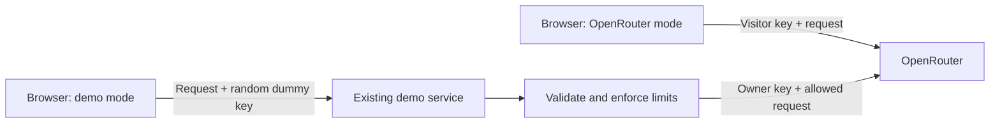

# Landing page, OpenRouter onboarding, and demo access

Status: draft  
Date: 2026-10-30  
Scope: landing-page requirements and integration considerations; not an approved implementation plan

Update: the owner supplied the demo API base URL `https://g1.lt/home/api/v1/ai-test/` and reports that it is not working yet. Its intended authentication contract accepts any random API key. Provider-profile/API-key sync has now been disabled in the app.

## 1. Requested direction

Turn the existing application into an online collection of LLM testing tools. The landing page should explain each tool through a card, then let visitors configure their OpenRouter API key or try a demo without a key. Direct OpenRouter use must keep the visitor's key away from every other server. Demo requests will use the owner's external service at `https://g1.lt/home/api/v1/ai-test/`, which is not operational yet and is intended to accept any random API key. The frontend should generate a dummy key for it. The requested server-side controls are rate, model, and per-IP request limits; those controls have not been independently verified in this repository.

The existing [codebase guide](codebase-guide.md) describes what is implemented. This document captures the requested direction and calls out decisions that remain open. No demo service needs to be created in this repository. The implemented sync filter keeps provider profiles and keys local; other changes below remain proposed.

## 2. Confirmed requirements

- Present cards for all four existing tools with clear descriptions and use cases.
- Seed loadable example requests for each tool and list those examples directly on its landing-page card. Users can load, inspect, edit, and explicitly run an example.
- Ask for an OpenRouter API key after introducing the tools.
- Clearly state that the visitor's key is never sent to any server except OpenRouter, once that guarantee is enforced.
- Advise a short expiration date and a small credit limit for the key.
- Provide a demo button that fills/selects the existing demo API URL and supplies a generated random dummy key without requiring a visitor key.
- Keep the owner's personal OpenRouter key exclusively on the demo server.
- Enforce rate limits, restricted model selection, and request quotas per IP address on that server.

## 3. Proposed page content

### Introduction

**Test LLMs before you build with them.**

Compare prompts, model responses, structured decisions, generated images, and extracted data in one browser workspace. Use your OpenRouter key, or try the limited demo without a key.

### Tool cards

| Card | Description | What it is for | Action / route |
| --- | --- | --- | --- |
| Chat & prompt testing | Build conversations and tool definitions. Run a single request or compare repeated calls across models and settings, with token, cost, and timing statistics. Add JavaScript checks and revisit saved batch results. | Prompt iteration, tool-call inspection, model comparisons, and response checks | Open chat tester → `/agent` |
| Structured decisions | Provide text or image context and ask yes/no, choice, or ordered-score questions. Compare typed answers and probabilities across calls. | Classification, confidence checks, and scoring experiments | Open decisions → `/decision` |
| Image generation | Generate images from text and optional references. Compare supported models, aspect ratios, resolutions, costs, and timings. | Exploring image prompts and comparing generation models | Open image generator → `/image` |
| Structured extraction | Turn images into JSON using your instructions and schema. Compare extraction results across vision models. | Receipts, forms, and other image-based data extraction | Open extraction → `/extract` |

Use these descriptions without implying automatic tool execution, saved result history for every tool, or text-only extraction. Each card should have a heading, readable description, use-case text, and keyboard-accessible action. Responsive cards should stack on narrow screens and use the existing Radix/UI-kit design system.

### Loadable examples on each card

Each tool card includes an **Examples** list below its description. Every item shows a title, a short explanation, and a **Load example** action. Keep **Open tool** as a separate action. Do not make the entire card a link containing nested buttons.

The requirement to seed examples is confirmed; the following initial catalog is proposed:

| Tool card | Loadable example | Seeded input | What users can check |
| --- | --- | --- | --- |
| Chat & prompt testing | Summarize a support ticket | A fictional ticket and a prompt requesting a short summary | Following instructions and concise output |
| Chat & prompt testing | Function-call request | A fictional weather question and a `get_weather` function definition | Tool selection and arguments; no real weather service is called |
| Chat & prompt testing | Prison prompt-injection test | The existing fictitious `prison` messages and `unlock_door` tool | Whether the model follows the system instructions when challenged |
| Structured decisions | Triage a support ticket | Fictional ticket context with yes/no, team-choice, and urgency-score questions | The three decision types and returned probabilities |
| Image generation | Product studio photo | A prompt for a fictional product on a plain background | Image output and supported generation settings |
| Image generation | Restyle a reference image | A bundled reference image and a transformation prompt | Image-to-image behavior on compatible models |
| Structured extraction | Extract a receipt | A bundled synthetic receipt image, instructions, and receipt schema | Merchant, totals, and line-item extraction |
| Structured extraction | Extract a contact card | A bundled fictional contact-card image and schema | Names, company, and contact fields in structured JSON |

Bundle synthetic images with the application so image examples are complete and do not depend on third-party image URLs. Include the images in the loaded configuration in the format expected by the current editors. Use fictional data and assets the project may distribute. Example descriptions explain what to inspect; they must not promise that every model produces the same answer.

### Seeding and loading behavior

- Maintain one versioned, typed example catalog shared by seeding and the landing-page cards. Each entry has a stable example ID, version, tool, title, description, request/configuration, optional bundled asset references, and required model capabilities. Do not maintain a separate hardcoded card list that can drift from the actual examples.
- Seed example records locally into the corresponding PouchDB record collections. Give them stable IDs using the existing record prefixes (`record:`, `decision:`, `image-gen:`, `extract:`), and distinguish their display names as examples.
- Make seeding idempotent and safe under concurrent startup. Add missing examples to existing installations as well as fresh databases; do not reuse the current “provider or chat record exists, skip all seeding” condition for the catalog.
- Track initialized example IDs/versions separately from provider setup. Do not overwrite edited records or silently restore deliberately deleted examples on every startup. New catalog entries may be added independently. An explicit **Load example** action can recreate a deleted example from the bundled catalog.
- Loading creates a fresh editable working copy with a new record ID and opens the appropriate editor. This keeps the bundled example reusable and lets chat batches satisfy their existing saved-record prerequisite. Changes and results belong to the working copy; they do not modify the catalog. Never replace an unrelated saved record or silently discard a draft; use the existing unsaved-changes flow.
- Loading is local and available without an API key, even while the demo backend is unavailable. It does not submit an LLM request or run a JavaScript test suite. Submission still requires an explicit **Submit** or **Start** action and a configured connection.
- Example requests work with either a personal-key provider or the demo profile. Loading an example must not switch providers or replace a visitor's key.
- Start with one task and one call. Select a compatible model from the active provider's allowed catalog when available; otherwise prompt for model selection. Do not bake unrestricted model IDs into examples or silently substitute an incompatible model. The chat single-call model is a UI preference, so the example loader must initialize it explicitly when a compatible model is resolved.
- Show capability/availability notes beside examples when relevant: **Requires image input**, **Requires decisions API**, **Personal key required**, or **Demo unavailable**. Loading remains available; unsupported execution is explained before submission.
- Seed requests/configuration, not fabricated run history or results. Optional reference output, if added later, must be labeled as an illustration rather than a live response. Users run the examples to check actual model behavior.

These are frontend fixtures and local records, not a reason to introduce a backend examples database. See [backend requirements](demo-backend-requirements.md#seeded-demo-requests-and-landing-page-examples) for the backend boundary.

### Connection section

Heading: **Choose how to connect**

Primary path: **Use my OpenRouter key**

- Password input with a visible label and an optional reveal control.
- Action: **Continue with OpenRouter**.
- Proposed privacy copy, publishable only after the safeguards below are implemented:

> Your API key is sent directly from your browser to OpenRouter. It is never sent to our servers or any other server. Use a dedicated key with a short expiration date and a small credit limit.

Add an accurate storage sentence after deciding whether keys live only for the session or can be remembered on the device. Do not claim encryption for the existing IndexedDB storage. The product will advise expiration and credit limits; it does not currently configure those limits for users.

Alternative path: **Try demo — no API key needed**

> Try selected models without your own key. Demo requests pass through our demo server and OpenRouter. Model availability, request rates, and requests per IP address are limited.

Use `https://g1.lt/home/api/v1/ai-test/` as the demo API base URL. Display it read-only when selected, or populate the existing URL control if that remains the chosen UI. Generate a fresh non-secret dummy key (for example, `demo-${randomUUID()}`) for the demo profile. A demo selection must never reuse or forward a previously entered visitor key.

The two privacy explanations belong beside their respective actions. Direct-key privacy wording must not imply that demo prompts bypass the demo server.

## 4. Proposed navigation and onboarding behavior

Replace only the `/` redirect with a landing-page route; preserve existing tool and saved-record URLs. Selecting a card remembers the intended tool and moves the visitor to connection setup when a connection is needed. After setup, continue to that tool. Existing configured visitors can open tools directly.

Recommended behavior is to allow browsing/editing without credentials and gate network calls. This preserves the app's local-first behavior. Load example always opens a local working copy without requiring credentials. The generic Open tool action may lead to connection setup when needed, but loading and inspecting examples must remain available offline once application assets are available.

Show the active mode and a Change connection action in the workspace. Switching modes preserves records and drafts. Provider/model caches must reflect the selected mode so demo-only suggestions do not leak into the direct connection, or vice versa. Switching to demo must clear any credential from the outgoing request context, while the policy for retaining a previously saved direct key remains explicit.

Connection errors should be actionable: invalid/expired key, insufficient credit, unavailable model, network failure, demo quota reached, or demo temporarily unavailable. Do not send a paid generation request merely to validate a key. If validation uses a provider endpoint, it must follow the same destination restriction.

## 5. Making the API-key promise true

The current implementation cannot truthfully publish the requested unconditional statement. The following are release requirements for the public OpenRouter-key flow:

| Current behavior | Required outcome |
| --- | --- |
| Provider keys are stored locally with provider profiles | Implemented: the sync filter excludes provider profiles and credential-bearing documents in both directions; local database exports still require care |
| Arbitrary `serverURL` is passed to every SDK operation | Bind OpenRouter keys to the canonical OpenRouter HTTPS API destination, including discovery and pricing calls |
| Test suites can read IndexedDB and use the network | Isolate untrusted suites from credentials and network access, or disable arbitrary suite execution in the public flow until isolation exists |
| All tools and discovery hooks require a nonempty key | Generate a random dummy key for the existing demo backend; the current readiness checks can remain |
| Errors can include upstream raw metadata | Ensure credentials are never echoed into errors, logs, analytics, or reports |

Destination checks must parse URLs and validate exact allowed origins/paths, rather than matching a hostname substring. Redirect handling must not forward credentials to an unapproved destination. Do not send keys in URL parameters or include them in telemetry.

Moving a key to localStorage alone does not solve the broader trusted-code problem. A separate-origin sandbox with tightly controlled messaging/network access, or removal of arbitrary-code execution from the public mode, needs a concrete design. The main application's credential path must remain separate from suite input. A same-origin Web Worker is insufficient.

The implemented filter excludes existing and new provider documents, including deletion tombstones. It preserves local keys and requires no credential migration to prevent further sync. It cannot remove copies already replicated to another server or retained in history/backups. Users with previously synced keys may need to revoke and replace them before relying on the new promise. Providers must be configured separately on each device.

Custom providers are an intentional existing capability. The proposed approach is to retain them as a separately explained advanced mode, with keys bound to that chosen provider, and scope the OpenRouter-only promise to the public OpenRouter connection. Removing custom providers or sync would be an architectural change requiring a decision.

## 6. Demo service boundary

The backend currently exposes only `/agent/submit`, per the owner. See [Demo backend requirements](demo-backend-requirements.md) for the proposed restricted proxy, exact SDK route mappings, and the required decisions routing correction.

The demo backend is external to this repository. Its base URL is `https://g1.lt/home/api/v1/ai-test/`, including the trailing slash. The owner reports that it is not working yet; availability and API compatibility have not been tested. Its intended contract accepts any random API key. The frontend can use the existing OpenRouter SDK adapter with this base URL and a generated dummy key once the service is available. Supported tool/API coverage remains to be confirmed. Treat this as a base URL, not a chat-completion route; verify SDK-generated request paths during integration.

Until the service is operational, the landing page should label the demo as unavailable rather than imply that it can successfully run requests.

The following are integration and operational requirements to confirm against the existing service, not a new-backend implementation scope:

1. Load the owner's key from a server-side secret store/environment, never from browser assets or a public build variable.
2. Accept only supported routes, methods, request shapes, and model IDs. Use a fixed upstream; do not accept an arbitrary upstream URL or credential from the caller.
3. Apply a short-window request rate and a longer-window per-IP quota before making an upstream call.
4. Enforce an allowlist per supported operation on the server. A client dropdown alone is not enforcement.
5. Cap output tokens, request body/image size, image count/resolution, concurrent requests, and request duration as appropriate for the exposed tool.
6. Use atomic/shared quota accounting if multiple service instances can handle requests. Define whether failed attempts consume quota; retries must not create an unmetered path.
7. Identify IPs only through the hosting platform's trusted proxy chain. Do not trust arbitrary client-supplied forwarding headers.
8. Restrict browser origins with CORS, while recognizing that CORS does not prevent direct scripted abuse.
9. Apply a global spend/request ceiling and an operator kill switch so rotating IPs cannot exhaust the owner's balance.
10. Sanitize upstream failures and avoid recording keys or prompt/image bodies by default. Define the retention policy for IP-based counters and operational logs.

The visitor supplies no API key in demo mode. The frontend supplies a generated random dummy key accepted by the backend, satisfying both the SDK and existing app readiness checks. Never insert the owner's key into the frontend. Verify the dummy key also works for model discovery and pricing, and never fall back to a saved visitor key.

### API surface and capabilities

| Tool | Service capability needed if enabled |
| --- | --- |
| Chat | Chat completions and a curated text-model catalog |
| Decisions | Decisions requests; a compatible decisions-model allowlist |
| Image generation | Image generation; supported image models and parameter metadata; pricing metadata if shown |
| Extraction | Chat completions with image input and structured-output schema; compatible vision-model catalog |

A proxy implementing only chat completions will not automatically support all four tools. Unsupported tools should remain visible in the landing catalog, but clearly indicate that a personal key is required. Whether demo launches with all four or a subset is undecided.

Proposed error behavior: return HTTP 429 for rate/quota exhaustion with a safe message and retry information when meaningful; reject unsupported models before contacting OpenRouter; return a clear unavailable response when the demo is disabled or its global budget is exhausted. The exact error envelope must match what the SDK and `formatRequestError` can consume. Do not silently retry quota failures in a way that generates more upstream calls.

## 7. Integration areas

These are affected areas for a later implementation plan, not instructions to change them now.

| Area | Work required |
| --- | --- |
| `src/router.tsx`, new landing page | Render the catalog at `/`; preserve deep links and base-path hosting |
| Example catalog, bundled assets, and local seeding | Seed all four record types idempotently; use the same catalog for card example lists; load editable copies without submitting |
| Provider hooks/settings | Create/select a separate demo profile with its URL and generated dummy key; preserve existing personal-key profiles |
| `src/hooks/use-completion.ts`, all four editor pages | Existing nonempty-key checks work with a dummy key; verify the selected demo profile is consistently used |
| Chat/image/vision discovery hooks | Use the demo profile and dummy key for supported discovery operations; existing provider ID/revision cache keys separate profiles |
| `src/lib/openrouter-client.ts` | Enforce destinations and credential attachment for every SDK operation |
| Model selection/task controls | Reflect demo capabilities and limits, with server-side enforcement remaining authoritative |
| Sync and response-test worker | Sync exclusion is implemented; worker isolation remains necessary before publishing the broader privacy guarantee |
| Existing demo service | Use the supplied base URL and confirm availability, supported operations, limits, model allowlists, and error behavior; no new backend is planned here |
| Tests and documentation | Verify mode separation and privacy; update README/SECURITY to match shipped behavior |

## 8. Acceptance criteria for the eventual implementation

- `/` displays all four tool cards and both connection choices on desktop and mobile.
- Cards describe implemented capabilities accurately and support keyboard navigation.
- Every card lists its loadable examples from the shared catalog, with descriptive labels and keyboard-accessible Load example actions.
- Fresh and existing databases receive missing examples without duplicates, overwritten edits, or automatic resurrection of deleted examples. Concurrent startup is safe.
- Loading creates an editable local copy in the correct tool, preserves the active provider, and never starts generation or suite execution.
- Image examples include bundled usable assets; no personal data or credentials appear in fixtures.
- Users can inspect examples while the demo is unavailable; unsupported model capabilities are explained before running.
- Reloading an example restores its original inputs in a new copy without changing previous copies or results.
- Visitors can select an intended tool and reach it after configuring a connection; existing deep links still work under `/` and a custom base path.
- OpenRouter mode shows the expiration/credit-limit advice and the approved storage/privacy copy beside the key input.
- Browser network inspection demonstrates that the visitor key reaches only OpenRouter across generation, validation, discovery, and pricing operations.
- Sync payloads, app-server requests, demo requests, logs, URLs, and error messages contain no visitor keys.
- Switching from a saved personal-key profile to demo sends no visitor credential; switching back restores the intended direct connection safely.
- Demo populates the configured URL and a generated random dummy key, without asking the visitor for a key or overwriting existing records.
- Unsupported models/routes are rejected server-side even when the client is bypassed.
- Concurrent requests cannot evade quota accounting. Tests cover limit windows, shared state, trusted-IP handling, spoofed headers, and global shutdown.
- Quota exhaustion produces useful UI feedback without automatic paid fallback to another mode.
- Unsupported demo tools are labeled before a user submits a request.
- Existing local-record, history, provider, unsaved-change, and batch behavior remains intact unless explicitly redesigned.

## 9. Open decisions

1. Demo readiness and verification of SDK-generated endpoint paths at the supplied base URL.
2. Demo tool coverage and exact allowed model IDs per operation.
3. Rate window, per-IP quota window/count, concurrency, payload/token/image limits, and total spend ceiling.
4. Session-only versus remembered visitor keys. Existing provider keys now stay local; previously replicated copies need separate handling.
5. How the public flow retains or separates custom provider profiles and remote sync.
6. Whether arbitrary JavaScript checks are isolated or temporarily unavailable in the public flow.
7. Final example titles/content/assets and the generic Open tool navigation behavior; Load example is available without a connection.
8. Demo data/log retention and quota accounting for failed attempts.

## 10. Out of scope for this documentation task

The sync filter and updated Settings guidance are implemented. Landing-page code, demo-button integration, production deployment, credential migration, account systems, and billing systems are outside this change. The demo API URL is supplied, but the backend is not operational yet. The application stack remains unchanged; a landing-page implementation plan can be derived once the remaining integration choices are settled.
