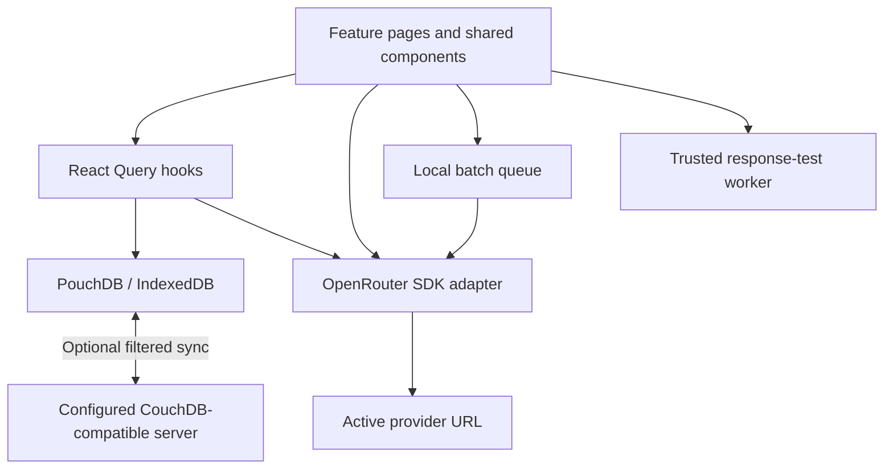

# LLM testing tools: codebase guide

Date: 2026-10-30  
Status: current implementation reference

This guide describes the repository's current working tree, including uncommitted changes. It covers the application, bundled UI kit, test organization, and build configuration. Dependencies, generated bundles, and local tooling databases are not first-party application code. See the [source map](source-map.md) for implementation links and the [landing-page draft](__DRAFT__landing-page-and-demo.md) for future requirements.

## 1. Product and current boundaries

`ai-test-agent` is a browser-based workspace for testing LLM requests through OpenRouter or compatible provider APIs. It contains four tools:

| Tool | What it does | Useful for | Current limitations |
| --- | --- | --- | --- |
| Chat testing | Edits chat messages and tool definitions; runs individual requests or batches with different model settings; compares responses, usage, cost, and duration | Prompt iteration, function-call inspection, model comparisons, repeatability checks, and JavaScript response assertions | Function calls are displayed, not automatically executed; batch runs require a saved record |
| Decisions | Sends ordered text/image context and typed questions; compares answers across repeated model calls | Yes/no confidence, classification, and ordered scoring | Requires a provider implementing the decisions API; saved records do not contain result history |
| Image generation | Generates images from a prompt with optional reference images and per-model aspect-ratio/resolution settings | Comparing image models, prompts, and reference-image behavior | Requires the image-generation API; generated results are kept in page memory |
| Structured extraction | Sends images, instructions, and a JSON schema; displays extracted JSON and call statistics | Receipt extraction and other image-to-structured-data experiments | The UI requires at least one image; JSON parsing is checked, but returned data is not locally validated against the schema |

The app has no application backend, account system, organization model, or server-side quota enforcement. Multiple visitors can use a hosted copy, but their browser storage is independent. “Local-first” describes editing and persistence; model calls still require network access. There is no service worker providing a separately managed offline installation.

There is currently no landing page or key-onboarding wizard. `/` redirects to chat. The owner supplied the external demo API base URL `https://g1.lt/home/api/v1/ai-test/`, but reports that it is not working yet. Its intended contract accepts any random API key; the backend is not implemented in this repository. Every tool currently requires a nonempty key, so the planned demo button can configure a dummy key without asking the visitor for a real one.

## 2. Stack and startup

| Concern | Implementation |
| --- | --- |
| Application | Vite SPA, React 19, TypeScript with strict compiler options |
| Routing | React Router 7 data router, `createBrowserRouter`, `useBlocker` |
| UI | Radix Themes, Lucide icons, CSS Modules, bundled `@untitled/ui-kit` Yarn workspace |
| Editors | CodeMirror through the UI kit's `JsonEditor`; direct CodeMirror for the batch JavaScript/JSON dock |
| Provider integration | `@openrouter/sdk`, centralized in `src/lib/openrouter-client.ts` |
| Persistence | PouchDB browser database backed by IndexedDB |
| Cache/mutations | TanStack React Query over local database operations and provider model discovery |
| Notifications | Sonner toast host inside `AppTheme` |
| Batches | Local worker-pool function, concurrency 5 in each feature page |
| Response assertions | Native Web Worker evaluating trusted JavaScript |
| Tests | Vitest, Testing Library, jsdom, fake-indexeddb |
| Package management | Yarn Classic 1.22.22, committed `yarn.lock` |

`main.tsx` loads Radix, UI-kit, and global styles, then mounts `App` under React StrictMode. `App` provides the shared theme, QueryClient, and router. Its mount effect seeds initial data, obtains settings, starts optional sync, and invalidates cached queries. Startup failures are caught without a fatal screen.

Seeding checks `provider:` and chat `record:` documents. If either collection is nonempty, it does nothing. Otherwise it creates an OpenRouter profile at `https://openrouter.ai/api/v1` with an empty key, makes it active, and saves the fictitious `prison` prompt-injection fixture. It also sets the last-used chat model to `google/gemini-3.1-flash-lite`. Concurrent seed calls share a promise. The emptiness test does not inspect the other three record collections.

## 3. Routes and navigation

Paths below are relative to `import.meta.env.BASE_URL`.

| Route | Component / behavior |
| --- | --- |
| `/` | Redirect to `/agent` |
| `/agent` | New chat record; single-call and batch tabs |
| `/agent/records` | Saved chat records |
| `/agent/:recordId` | Existing chat record |
| `/decision` | New decisions configuration |
| `/decision/records` | Saved decisions configurations |
| `/decision/:decisionId` | Existing decisions configuration |
| `/image` | New image-generation configuration |
| `/image/records` | Saved image configurations |
| `/image/:imageId` | Existing image configuration |
| `/extract` | New extraction configuration |
| `/extract/records` | Saved extraction configurations |
| `/extract/:extractId` | Existing extraction configuration |
| `/settings` | Provider profiles and optional sync |
| `/:promptId/multiple` | Legacy redirect to `/agent/:promptId?tab=multiple` |

The chat tab is initialized from `?tab=multiple` once. Subsequent tab changes use local state, preserving the in-memory workspace without triggering route blocking.

`Toolbar` provides New, Load, Save, Save As, tool navigation, and Settings, with a mobile menu. Each editor supplies its own Load path. `RecordsList` supplies case-insensitive name filtering, updated timestamps, navigation, and delete confirmation to all four list pages. `PageLayout` supplies the centered list/settings shell.

`useUnsavedChanges` shares route and in-page discard handling. Each editor computes its own dirty snapshot. Leave clears the dirty ref before proceeding; Stay/Escape retains changes. This is in-app navigation protection, not a complete browser-close backup mechanism.

Cmd/Ctrl+S saves. Cmd/Ctrl+Enter submits chat in the single-call tab or starts a batch in the other three editors when their prerequisites are met.

## 4. Application and request flow



Pages own editor state, request prerequisites, run progress, and save behavior. Hooks own local CRUD, provider selection, and model-query caching. The adapter translates application types to SDK shapes and normalizes responses. The shared batch helper does not know about providers or React.

Every adapter operation constructs `new OpenRouter({ apiKey, serverURL })` from the active profile. Most operations use that configurable URL. **Exception found in installed SDK 1.4.14:** decisions use an operation-specific OpenRouter origin unless the call receives its own server override; the current adapter does not supply it. See [backend requirements](demo-backend-requirements.md) for observed URLs and the required fix. There is no separate handcrafted HTTP client.

| Operation | SDK method | Important behavior |
| --- | --- | --- |
| Chat completion | `client.chat.send` | Non-streaming; maps messages and optional tools, temperature, reasoning effort, token limit |
| Decisions | `client.alpha.decisions.create` | Sends `model`, ordered `state`, and named `questions` |
| Images | `client.images.generate` | Requests one image per call; optional references, aspect ratio, resolution; explicit 180-second timeout |
| Extraction | `client.chat.send` | Multimodal user message plus strict `json_schema` response format; explicit 120-second timeout; parses response JSON |
| Chat model discovery | `client.models.list` | Filters by text output modality |
| Vision model discovery | `client.models.list` | Filters by image input modality |
| Image model discovery | `client.images.listModels` | Reads aspect ratios, resolutions, and image-input capability |
| Image price discovery | `client.images.listModelEndpoints` | Selects cheapest reported output-image price across endpoints |

Chat compatibility alone is insufficient for decisions, image generation, or all discovery operations. A custom server must implement the corresponding API surface.

The adapter normalizes usage to `prompt_tokens`, `completion_tokens`, `total_tokens`, and optional `cost`. Missing token counts generally become zero; missing cost remains absent. Array-form content is reduced to text parts. Generated base64 images become browser data URLs. Provider error metadata may be appended to visible errors.

Model-discovery hooks are enabled only when the active key is nonblank. Cache keys include provider ID and revision, so editing a URL/key selects a fresh cache entry; results have infinite stale time. Discovery may therefore contact a provider without an explicit generation click. Image pricing performs additional endpoint queries and tolerates individual lookup failures.

`ModelAutoComplete` remains a free-text input. When provider suggestions are supplied, they replace custom-history suggestions and typed values are not added to custom history. Otherwise new values can be persisted and deleted. Suggestions are not a server-enforced model allowlist.

## 5. Chat testing

The chat page combines two workflows in one component.

### Single call

The payload is a JSON string containing `messages` and optional `tools`. JSON mode uses the shared editor; Form mode renders message blocks, function-tool cards, and an OpenRouter web-search toggle. Messages support system, user, assistant, and tool roles. Tool cards edit names, descriptions, and typed properties with required flags; they are not a complete arbitrary JSON Schema editor.

`parsePayload` checks that JSON parses to an object with a messages array; it does not exhaustively validate every provider-specific field. Invalid payloads block chat saves/submission. An assistant final message triggers a confirmation before submitting.

The result panel shows prompt/total tokens, reported cost, client duration, text, tool calls, optional reasoning, and raw JSON for the first choice. Append adds the assistant message and an empty tool response placeholder per tool call. It does not execute those tools. A fullscreen overlay displays elapsed time while a single call is pending.

### Batch calls

Each task has an ID, model, temperature, optional reasoning effort, optional max tokens, and an excluded flag. Call count is clamped to 1–20. There is no equivalent hard cap on the number of tasks. The page creates one job per active task × call count and uses concurrency 5.

Each job catches provider failures into a typed failure result with duration. Results and progress update incrementally. Excluded tasks retain previous results. The shared pool itself does not catch arbitrary job exceptions; feature jobs supply that handling.

A chat record must exist before a batch starts. **The request uses the current editor `content`, including unsaved edits**, rather than re-reading only the stored prompt. At completion, `persistRun` saves current name/content/configuration and prepends a timestamped result snapshot. This differs from older project prose claiming only saved content is run.

History entries contain `{ id, createdAt, tasks, callCount, results }`; results are arrays aligned with snapshot tasks. They do not embed the exact prompt or test-suite source for each run. Therefore old snapshots preserve outputs and settings, but are not complete reproducibility archives after a prompt or suite changes. Selecting history makes task controls read-only; returning to live allows editing. Legacy `multipleResults` JSON is migrated on read.

Comparison tables show responses/errors, progress, usage, reported cost, duration, and test results. Missing cost is not represented as a guaranteed free call. Timing includes settled failures; token and price aggregates use available successful-result data.

### JavaScript assertions

The bottom dock contains a JavaScript suite editor and read-only raw batch JSON. A suite returns `{ name, fn }[]`; each function receives the first choice's message from a successful call. Checks may be asynchronous. The default check requires content or tool calls.

Supported assertions: `toBe`, `toEqual`, `toContain`, `toMatch`, `toBeTruthy`, `toBeFalsy`, `toBeDefined`, `toBeGreaterThan`, and `toBeLessThan`. `toEqual` compares JSON serialization; this is a small Jest-like API, not Jest itself.

`TestRunner` runs jobs sequentially with request IDs and a two-second timeout per job. Timeout terminates and replaces the worker; explicit termination settles pending work without reviving it. Suite build errors, worker errors, malformed suites, and individual assertion failures become visible failures.

The worker uses `new Function`. It has no DOM but can access IndexedDB and the network, including stored credentials. It isolates CPU work from the UI thread, not untrusted code from application data. Only trusted suites should run.

## 6. Decisions, images, and extraction

All three editors support multiple model tasks, exclusion, repeated calls, incremental progress, and five concurrent jobs. They can run without first saving a record. Their records store input configuration; response results remain in component state and are not saved as chat-style history.

### Decisions

`StateList` builds ordered text and image context. `QuestionCard` supports:

- `noul`: yes/no criteria with a returned probability.
- `choice`: named options and descriptions with a winning option and probability distribution.
- `score`: ordered labels with a winning label and probability distribution.

Form and JSON modes serialize through `decision-utils.ts`. Blank question names are omitted; later duplicate names overwrite earlier ones. Image uploads use the shared resampler. Tasks default to `~typesafe/jev-latest`; the model remains editable. Results group the answers from each call into a table cell with formatted percentages. This is the current `/decision` implementation, not the earlier proposed `/typesafe` page.

### Image generation

Input consists of a nonblank prompt, optional reference images, tasks, and call count. Provider metadata supplies per-model aspect-ratio/resolution options. If reference images are present and discovery explicitly says a model cannot accept them, that task produces skipped failures locally while other tasks continue. Unknown capability is not treated as a prohibition.

Generated thumbnails open a larger dialog. Price labels are indicative metadata, not a guaranteed total charge. Generated images are not included in saved configuration records.

### Extraction

Input consists of instructions, schema text, images, tasks, and call count. The UI requires at least one image and an object-shaped JSON schema. Blank instructions use a default extraction instruction. The default schema describes a receipt, including merchant, totals, and line items, using required fields and nullable values.

The adapter asks the provider for strict structured output, then parses the returned content with `JSON.parse`. There is no additional client-side schema validator. Invalid response JSON becomes a failed call. Although the lower-level adapter accepts an empty image list, the current UI does not offer text-only extraction.

### Image handling

`ImagePicker` supports upload, clipboard image paste, removal, reordering, and zoom. Decision state supports image upload and reordering. Files pass through `resampleImage`: longest dimension capped at 1024 pixels without upscaling, rendered on a white canvas, then encoded as JPEG at quality 0.9. Input data URLs and filenames can be stored with configuration records/drafts. This affects original resolution and transparency.

## 7. Persistence and state lifetime

The single PouchDB database is named `ai-test-agent`. Documents use `_id` prefixes and `type` discriminators; updates require `_rev`. Prefix scans use `allDocs`, not Mango indexes. Record lists sort by `updatedAt` descending in memory. Hooks invalidate their query families after mutations.

| Document prefix / ID | Type | Persisted content |
| --- | --- | --- |
| `record:<uuid>` | `AgentRecord` | Name, chat payload string, batch tasks/count/suite/history, timestamps; optional legacy results |
| `decision:<uuid>` | `DecisionRecord` | Name and JSON string of state, questions, model tasks, call count, timestamps |
| `image-gen:<uuid>` | `ImageGenRecord` | Name and JSON string of prompt, input images, tasks/settings, call count, timestamps |
| `extract:<uuid>` | `ExtractRecord` | Name and JSON string of instructions, schema text, input images, tasks, call count, timestamps |
| `provider:<uuid>` | `ProviderProfile` | Label, server URL, **plaintext API key**, timestamps |
| `model:<uuid>` | `CustomModel` | Custom model string and creation time |
| `app-settings` | `AppSettings` | Active provider ID and optional remote sync URL/enabled flag |

Save As creates a fresh document and navigates to it. Save updates the current document and timestamp. Deleting an active provider clears the selected provider ID. Initial settings creation handles a concurrent-create conflict by reading the winning document.

Local storage uses the `ai-test-agent:` prefix:

| Key suffix | Purpose |
| --- | --- |
| `editor-mode` | Chat JSON/Form preference |
| `last-model`, `last-temperature`, `last-reasoning-effort`, `last-max-tokens` | Last single-call parameters, independent of saved chat records |
| `decision-draft` | Unsaved new decisions configuration |
| `image-gen-draft` | Unsaved new image configuration |
| `extract-draft` | Unsaved new extraction configuration |

The latter three draft stores are best-effort and apply to new records, not automatic backups of edits to an existing record. Large image data can exhaust browser storage. Clearing site data removes local records; a different origin or browser profile has a separate database.

Optional sync calls `db.sync(remoteURL, { live: true, retry: true, filter: shouldSyncDocument })`. Settings changes cancel/restart the handle; startup resumes it. Sync is off by default and errors/denials produce toasts. It excludes provider documents by ID prefix/type and connection settings by ID/type, plus documents with top-level `apiKey` or `syncRemoteURL` fields, in both directions. Provider/settings deletion tombstones are excluded by ID too. Records, model history, and executable suite source still replicate. Configure providers and connection settings separately on each device. Previously synced remote credentials are not deleted; rotate affected provider keys and database passwords. Local-storage preferences/drafts are not part of PouchDB sync. There is no application-level multi-user permissions model or conflict-resolution UI.

## 8. Shared UI and styling

The bundled UI kit exports `AppTheme`, `UI_THEME`, `JsonEditor`, `DockPanel`, `LoadingOverlay`, and `useResizableHeight`. Vite consumes its TypeScript source directly; there is no separate package build or private-registry requirement. The theme uses indigo/slate with medium radii, semantic CSS aliases, and a toast host.

Reuse these components for their existing responsibilities. Application CSS Modules cover workspace layouts, sticky comparison tables, cards, thumbnails, and mobile behavior. The chat layout stacks below 1024px; the other editors stack below 900px; the toolbar switches to its mobile menu at 640px. The dock is fixed to the viewport bottom and grows upward when resized.

## 9. Privacy and hosting implications

Today, the accurate statement is: **the app sends model requests to the configured provider and stores provider profiles/API keys unencrypted in the browser, excluding them from optional database sync.** This is not yet the requested guarantee that a user key can only be sent to OpenRouter.

The following boundaries still matter before publishing that stronger promise:

1. Custom profile URLs can receive the configured key, including during model discovery.
2. Older app versions may already have synced credentials. The new filter prevents further provider replication but cannot erase remote copies or backups.
3. Trusted test suites can read credentials and make network requests.

The [landing-page draft](__DRAFT__landing-page-and-demo.md) records the required changes and separates direct-key use from demo use. A warning alone does not make the stronger guarantee true. Do not put a shared demo key into client source, Vite environment variables, or public assets.

## 10. Development, verification, and deployment

The package declares Node `^24.15.0 || >=26.0.0`; `.nvmrc` selects the 24 line. Use Yarn Classic 1.22.22.

```sh
yarn install --frozen-lockfile
yarn dev
yarn typecheck
yarn lint
yarn test
yarn build
yarn preview
```

The dev server uses port 5174. `build` runs TypeScript checks before Vite emits `dist/`. `APP_BASE_PATH` defaults to `/` and controls both assets and router basename; for a subdirectory build, use for example `APP_BASE_PATH=/llm-test/ yarn build`.

Deploy `dist/` to an HTTPS static host with SPA fallback to `index.html`, including deep links beneath the configured base path. Provider APIs need appropriate browser CORS support. Vite dev/preview are not the production service. The external demo backend is operated separately at `https://g1.lt/home/api/v1/ai-test/` and is intended to accept a random dummy API key. It is not working yet according to the owner; availability and SDK path compatibility remain unverified.

GitHub Actions installs dependencies, runs lint/tests, and builds on push and pull request. Tests are colocated with components, hooks, pages, and library modules. Shared setup supplies fake IndexedDB and browser API shims; the render helper uses a data router so `useBlocker` works. UI-kit resize tests run with the app suite.

Tests exercise local CRUD, provider changes, batch scheduling, editing interactions, model discovery, image processing dimensions, SDK request/response translation, and worker timeout/error behavior. SDK and browser APIs are mocked where appropriate. These tests do not prove live provider compatibility, CORS, production quota behavior, or the proposed privacy promise. The original documentation pass checked links and structure. Credential-filter tests now exercise real local PouchDB replication in both directions, including provider edits/deletions, ordinary record deletion, and legacy remote credentials; a hook test verifies the filter is attached to live sync.

The source and bundled UI kit carry the repository's PolyForm Noncommercial license. Consult `LICENSE` for its terms; this guide does not change them.

## 11. Differences from older project descriptions

- There are four tools; `/` redirects to `/agent`, and records lists live under each tool.
- The former TypeSafe proposal became a persisted, batch-capable `/decision` feature.
- Provider discovery supplies model suggestions/pricing; custom history remains a fallback capability.
- Chat batches submit current editor content and persist it after the run.
- Only chat batches persist output history; other saved records contain configuration.
- Extraction currently requires images in the UI.
- Remote sync excludes provider profiles and API keys; the test worker remains trusted-code execution.
- Landing-page onboarding is future work; the external demo API URL is supplied, but the service is not operational yet; its intended contract accepts any random key.
